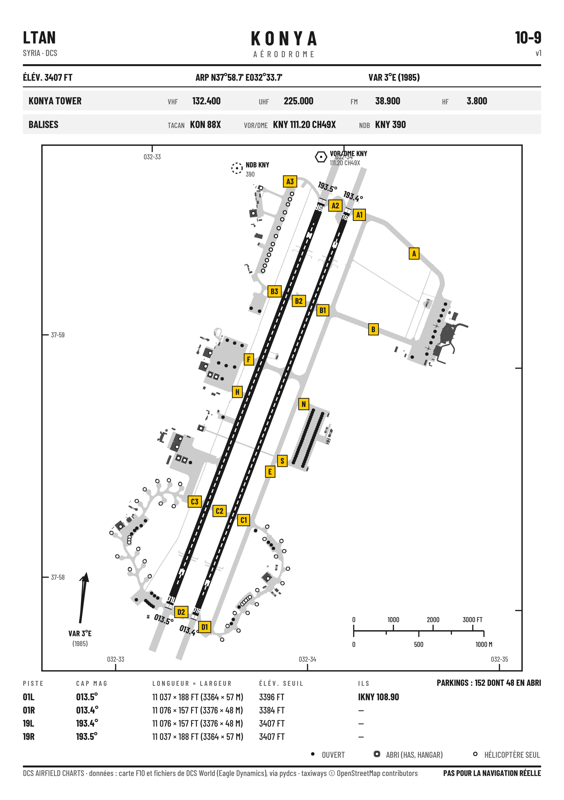
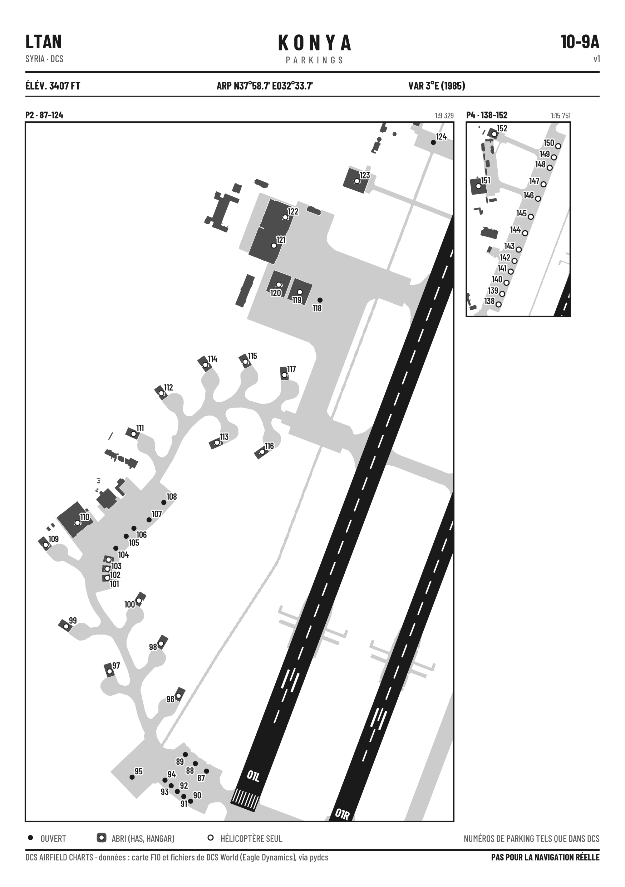
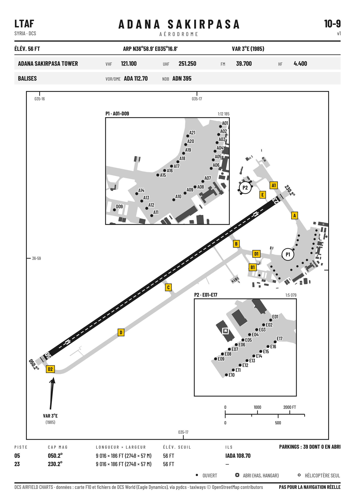
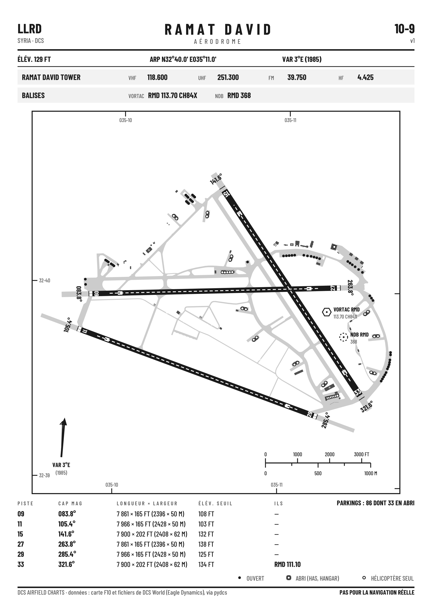
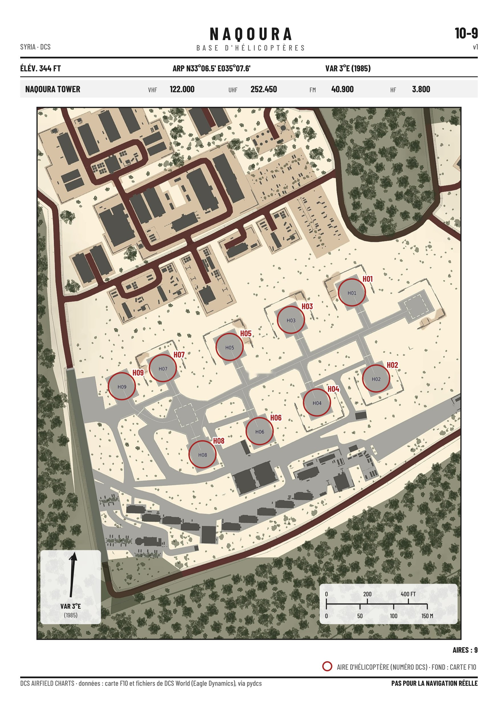
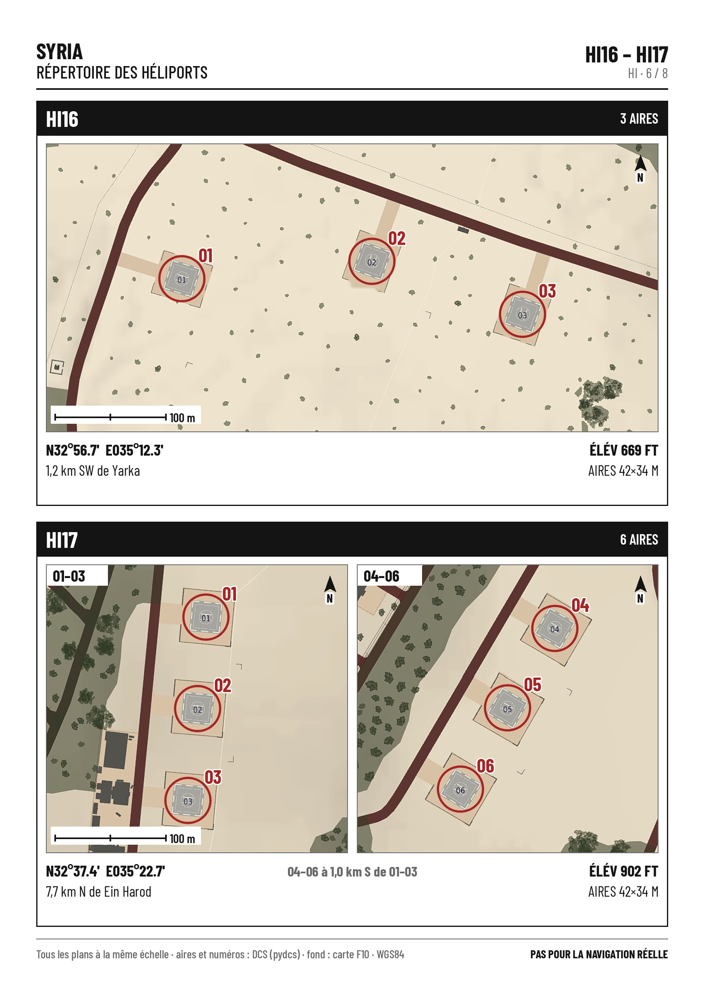

# DCS Airfield Charts

Airfield charts for DCS World, built from the game's own data.

**Status: work in progress.** The DCS F10 map (Alt mode) draws all the pavement of an airfield as flat fills, along with buildings, guidance lines and parking numbers. This repository contains the tool that captures that map, base by base, in the DCS terrain frame (`x` North, `z` East, in metres). The whole Syria theatre (80 airbases, 144 heliports) and the whole Cold War Germany theatre (119 airbases, 108 heliports) are captured. The renderer, which turns a capture into an A5 chart (page 10-9, plus parking pages 10-9A, 10-9B… when needed), is in `render/` (see "Rendering charts").

The goal is to share a complete set of charts for every airfield, as PDF and PNG, ready for print and for the DCS kneeboard.

## Download the charts

**Syria — 78 of the 80 airfields and helicopter bases, plus every heliport** (magnetic declination for 1985), rendered with no manual drawing.

- One PDF per airfield and helicopter base (all its pages): see the list in [`downloads/syria/`](downloads/syria/README.md).
- **Heliport directory**: the 141 other heliports, four to a page — a plan of the pads with their numbers, position, elevation and nearest town, with an index: [Syria_heliports_directory.pdf](downloads/syria/Syria_heliports_directory.pdf?raw=true).
- Two zips, attached to the latest release, with every chart page as PDF, PNG (1748 × 2480 px, for the DCS kneeboard) and SVG (Inkscape layers):
  - **Airfields**: the 73 airfields — [DCS_Airfield_Charts_Syria_1985_airfields.zip](https://github.com/MirabelleBenou/dcs-airfield-charts/releases/latest/download/DCS_Airfield_Charts_Syria_1985_airfields.zip);
  - **Helicopters**: the 8 helicopter bases, plus the heliport directory (PDF, and its pages as JPEG for the kneeboard) — [DCS_Airfield_Charts_Syria_1985_helicopters.zip](https://github.com/MirabelleBenou/dcs-airfield-charts/releases/latest/download/DCS_Airfield_Charts_Syria_1985_helicopters.zip).
- **Route Planner**: every chart page and heliport directory page as an image, with an index that names the DCS airfield or heliport of each page, read by the Route Planner of [DCS Mission Plan](https://github.com/MirabelleBenou/dcs-mission-plan) — [DCS_Airfield_Charts_Syria_1985_route_planner.zip](https://github.com/MirabelleBenou/dcs-airfield-charts/releases/latest/download/DCS_Airfield_Charts_Syria_1985_route_planner.zip).

**Cold War Germany — 94 airfields, 108 heliports** (magnetic declination for 1985), from the large NATO and Warsaw Pact bases to the motorway strips.

- One PDF per airfield (all its pages): see the list in [`downloads/germanycoldwar/`](downloads/germanycoldwar/README.md).
- **Heliport directory**: the 108 heliports, four to a page — a plan of the pads with their numbers, position, elevation and nearest town, with an index: [GermanyColdWar_heliports_directory.pdf](downloads/germanycoldwar/GermanyColdWar_heliports_directory.pdf?raw=true).
- One zip, attached to the latest release, with every chart page as PDF, PNG and SVG: [DCS_Airfield_Charts_GermanyColdWar_1985_airfields.zip](https://github.com/MirabelleBenou/dcs-airfield-charts/releases/latest/download/DCS_Airfield_Charts_GermanyColdWar_1985_airfields.zip).
- **Helicopters**: the heliport directory (PDF, and its pages as JPEG for the kneeboard) — [DCS_Airfield_Charts_GermanyColdWar_1985_helicopters.zip](https://github.com/MirabelleBenou/dcs-airfield-charts/releases/latest/download/DCS_Airfield_Charts_GermanyColdWar_1985_helicopters.zip).
- **Route Planner**: every chart page and heliport directory page as an image, with an index that names the DCS airfield or heliport of each page, read by the Route Planner of [DCS Mission Plan](https://github.com/MirabelleBenou/dcs-mission-plan) — [DCS_Airfield_Charts_GermanyColdWar_1985_route_planner.zip](https://github.com/MirabelleBenou/dcs-airfield-charts/releases/latest/download/DCS_Airfield_Charts_GermanyColdWar_1985_route_planner.zip).
- Not yet: ICAO codes and taxiway names (from OpenStreetMap), and the 25 grass strips whose runway the F10 map does not draw.

- What changed from one version to the next: [CHANGELOG.md](CHANGELOG.md) (each version is also a GitHub release).

Not yet covered: T3, which the F10 map does not draw; Nicosia, which pydcs does not list as an airfield; the heliport HMed22, which has no taxiway points in DCS and could not be captured. Runways are found on the F10 map guided by the game's runway list, so their count and names follow DCS (including the parking names DCS repeats at some bases). Taxiway names appear only where OpenStreetMap has them. These charts are for DCS only, not for real-world navigation.

## Example charts

Examples from Syria: three airfields, a helicopter base and a page of the heliport directory, rendered by `render/build_chart.py` and `render/build_directory.py` from the F10 capture and the game files, with no manual drawing. A5 portrait, magnetic declination for **1985** (the default; `--annee` changes it). Every page comes as **SVG** (vector, organised as Inkscape layers; editing needs the Barlow Condensed fonts from `render/fonts/`), **PNG** (1748 × 2480 px, 300 dpi, ready for the DCS kneeboard) and **PDF** (one file per airfield, all pages). The links download the files themselves; when saving from a GitHub file page, use its *Download raw file* button (saving the page itself gives an HTML file that Inkscape cannot open).

| Airfield | PDF (all pages) | 10-9 (airfield) | Parking pages |
|---|---|---|---|
| Konya (LTAN) | [LTAN_Konya_charts.pdf](docs/examples/syria/LTAN_Konya_charts.pdf?raw=true) | [SVG](docs/examples/syria/LTAN_Konya_10-9.svg?raw=true) · [PNG](docs/examples/syria/LTAN_Konya_10-9.png?raw=true) | 10-9A: [SVG](docs/examples/syria/LTAN_Konya_10-9A.svg?raw=true) · [PNG](docs/examples/syria/LTAN_Konya_10-9A.png?raw=true) — 10-9B: [SVG](docs/examples/syria/LTAN_Konya_10-9B.svg?raw=true) · [PNG](docs/examples/syria/LTAN_Konya_10-9B.png?raw=true) |
| Adana Sakirpasa (LTAF) | [LTAF_Adana_charts.pdf](docs/examples/syria/LTAF_Adana_charts.pdf?raw=true) | [SVG](docs/examples/syria/LTAF_Adana_10-9.svg?raw=true) · [PNG](docs/examples/syria/LTAF_Adana_10-9.png?raw=true) | none: parking insets inside the plan |
| Ramat David (LLRD) | [LLRD_Ramat_David_charts.pdf](docs/examples/syria/LLRD_Ramat_David_charts.pdf?raw=true) | [SVG](docs/examples/syria/LLRD_Ramat_David_10-9.svg?raw=true) · [PNG](docs/examples/syria/LLRD_Ramat_David_10-9.png?raw=true) | 10-9A: [SVG](docs/examples/syria/LLRD_Ramat_David_10-9A.svg?raw=true) · [PNG](docs/examples/syria/LLRD_Ramat_David_10-9A.png?raw=true) |

| Konya 10-9 | Konya 10-9A |
|---|---|
|  |  |

| Adana 10-9 | Ramat David 10-9 |
|---|---|
|  |  |

**Helicopters.** A helicopter base with no runway is drawn on the softened F10 map, each pad circled in red at its real size with its DCS number. The heliport directory gives the other heliports four to a page, all at the same scale, with position, elevation, pad sizes and the nearest town (the charts are in French: « 1,2 km SW de Yarka » is 1.2 km south-west of Yarka).

| Helicopter base | PDF | 10-9 |
|---|---|---|
| Naqoura | [Naqoura_charts.pdf](docs/examples/syria/Naqoura_charts.pdf?raw=true) | [SVG](docs/examples/syria/Naqoura_10-9.svg?raw=true) · [PNG](docs/examples/syria/Naqoura_10-9.png?raw=true) |

| Naqoura 10-9 (helicopter base) | Heliport directory, page 11 (HI16, HI17) |
|---|---|
|  |  |

What a chart shows: pavement, runways and their markings, buildings and hardened shelters (vectorised from the F10 map); runway designators, magnetic bearings, lengths and threshold elevations; tower frequencies, TACAN, VOR, NDB and ILS (from the game files); every parking spot with its number as in DCS; real taxiway names where OpenStreetMap has them; latitude/longitude ticks, true and magnetic north, a scale in feet and metres.

## Contents

| Path | Role |
|---|---|
| `capture/hook/ChartsCaptureHook.lua` | DCS export hook: a small local server (`127.0.0.1:47123`) that places the F10 camera directly above a point, with its axes aligned to the DCS grid; releases the camera after 5 s without a command |
| `capture/f10capture.py` | captures a whole base: extent read from its `.rn4`, camera altitude adapted to the terrain, scale calibration (falls back to the predicted scale if calibration fails), image grid, mosaic; `index <Theatre>` lists every airbase and heliport of a theatre; `theatre <Theatre>` captures them all in one resumable pass (about 45 min for Syria) |
| `capture/f10probe.py` | the original probe (link, stabilisation, scale, alignment) |
| `render/` | the renderer: vectorises a captured base (pavement, buildings, runways), reads the game facts through pydcs, lays out the A5 pages and exports SVG, PDF and PNG; `build_chart.py` renders a base, `fetch_osm.py` downloads real taxiway names from OpenStreetMap; fonts in `render/fonts/` |
| `tests/` | `python -m pytest`; the tests that need captured samples or DCS files run when `DCS_CHARTS_SAMPLES` points to a folder holding them, and are skipped otherwise |
| `downloads/` | the published charts: one PDF per airfield in `downloads/<theatre>/` (with its index), and a zip per theatre holding every page as PDF, PNG and SVG |

## Installation (Windows)

1. Copy `ChartsCaptureHook.lua` to `Saved Games\DCS...\Scripts\ChartsCapture\`.
2. Append to the end of `Saved Games\DCS...\Scripts\Export.lua`:
   `dofile(lfs.writedir()..[[Scripts\ChartsCapture\ChartsCaptureHook.lua]])`
3. Python 3.12+ with `numpy`, `mss`, `pillow`.
4. Set up the configuration (see below).
5. Start a mission on the theatre you want, open the F10 map in Alt mode, hide labels and units, keep DCS in the foreground; then run `python -I capture/f10capture.py capture <Theatre> <Base>`.

### Configuration

Copy `capture/config.example.json` to `capture/config.json` (ignored by git) and adapt it to your PC:

| Key | Meaning |
|---|---|
| `work_dir` | working folder (required): the scripts write `out/` and `sync/` there; created if it does not exist |
| `dcs_install` | DCS World installation folder (required): terrains are read from `<dcs_install>/Mods/terrains`, which must exist |
| `screen` | screen size in pixels, `[width, height]` (optional: it can be left out, in which case the size of the primary screen is used) |
| `annee` | rendering only (optional, default `1985`): year used for the magnetic declination; a decimal such as `1987.5` is accepted |
| `osm_dir` | rendering only (optional, default `<work_dir>/osm`): where the OpenStreetMap taxiway names are read and written |

The file is looked up in this order: the `--config <path>` command-line option, otherwise the `DCS_CHARTS_CONFIG` environment variable, otherwise `capture/config.json`. `~` is expanded. If the file is missing or incomplete, the script stops with a message saying so.

## Rendering charts

Dependencies: Python 3.12+ and `pip install -r requirements.txt`. The game facts (airfield, runway headings, parking slots, tower frequencies) are read with [pydcs](https://github.com/pydcs/dcs), pinned to one commit and imported as a library; the navaids are read from `<dcs_install>/Mods/terrains/<Theatre>/beacons.lua`. [CairoSVG](https://cairosvg.org/) needs the Cairo library: on Linux and macOS it comes with the system packages; on Windows install the GTK runtime, or run the renderer under WSL.

Theatres rendered so far: **Syria** and **GermanyColdWar** (captured in full; pydcs keeps it under its `germany` module, the theatre name stays `GermanyColdWar` everywhere, and the chart header reads GERMANY COLD WAR).

```
python -I render/build_chart.py <Theatre> <Base> [--annee 1985] [--icao LTAN] [--osm <file>] [--out <folder>] [--config <path>]
```

Input: the captured base folder `<work_dir>/out/<theatre>/<Base>/` (`mosaic.png`, `base.json`, `tiles.json`). Output, in `<work_dir>/charts/<theatre>/` unless `--out` is given: `<ICAO>_<Base>_10-9.{svg,pdf,png}`, the same for the parking pages `10-9A`, `10-9B`…, and the collected `<ICAO>_<Base>_charts.pdf`. Pages are A5 portrait; PNGs are 1748 × 2480 px (300 dpi). `--annee` sets the year of the magnetic declination (IGRF-14, 1 July of that year; default **1985**, or the `annee` key of `config.json`). Without `--icao` and without an OpenStreetMap file the base name replaces the ICAO code.

Real taxiway names come from OpenStreetMap (optional): `python -I render/fetch_osm.py <Theatre> [--bases A,B…] [--force]` queries the Overpass API once per captured base and writes `<osm_dir>/<theatre>/<Base>.json`; a base already fetched is skipped unless `--force`, a failure does not stop the pass, and `run.json` in the same folder gives the outcome. Without this file, charts have no taxiway labels.

The SVG pages are organised as Inkscape layers (Pavement, Runways, Parking numbers, Taxiway labels…, one sub-layer per parking inset), so a layer can be hidden or edited without touching the rest; editing an SVG needs the Barlow Condensed font installed (the `.ttf` files are in `render/fonts/`).

The pages for the Route Planner of [DCS Mission Plan](https://github.com/MirabelleBenou/dcs-mission-plan) are packed from the zips of a release, without drawing anything again:

```
python -I render/build_fiches.py <Theatre> --zips <airfields zip> <helicopters zip> --airfields <airfields.json> --edition AC-V1.4.2 --out <folder>
```

Input: the *airfields* and *helicopters* zips of the theatre (`GermanyColdWar` or `Syria`) and the `airfields.json` of Mission Plan. Each chart is matched to its DCS airfield by the ARP written on its page (the nearest airfield of `airfields.json`, 500 m at most); each heliport is matched to its box on a directory page by replaying the directory layout with `render/directory.py` and pydcs alone, and the replay is checked against the published pages (it stops, writing nothing, if a page does not match). Output: `<folder>/<Theatre>/` with the page images (a page over 1 MB is re-encoded as JPEG) and `index.json` (format `dcs-fiches-v1`), and `<folder>/DCS_Airfield_Charts_<Theatre>_1985_route_planner.zip` with the same files at its root. An existing output folder is never overwritten.

Tests: `python -m pytest` (see the table above for the tests that need samples).

Credits and licences: [pydcs](https://github.com/pydcs/dcs) (LGPL, imported, no code copied); [ppigrf](https://github.com/IAGA-VMOD/ppigrf) for the IGRF-14 geomagnetic field; taxiway names © OpenStreetMap contributors, [ODbL 1.0](https://www.openstreetmap.org/copyright), attribution printed on the charts that use them; [Barlow Condensed](https://github.com/jpt/barlow) (SIL Open Font License 1.1, `render/fonts/OFL.txt`); [CairoSVG](https://cairosvg.org/) (LGPL) and [pypdf](https://github.com/py-pdf/pypdf) for the exports.

## What we measured

- Image aligned with the DCS grid (deviation < 0.01°), seams between images ≤ 1 px, about 1 s per image.
- Scale: 0.33555 mm/px per metre of camera altitude. **DCS keeps the F10 camera at least ~500 m above the ground**; hence the altitude `max(1350, ground + 700)` and a calibration for each base.

## Licence

MIT — see `LICENSE`.

## Acknowledgements

**How this project is built.** DCS Airfield Charts is built with [Claude](https://www.anthropic.com/claude), Anthropic's AI: it designed the methods, wrote the code and produced the charts, working as project lead and developer. Benoit (KHR-26 / 4th VEAW), a sim pilot with an IT background but not a developer or a graphic designer, had the idea, made the decisions and checked the results.

Thanks to the pilots of the 4th VEAW for testing.

**Standing on the shoulders of the chart makers.** For years the DCS community has flown with charts drawn by hand by a few people. Their work set the standard these charts are measured against, and it was studied closely while this project was designed:

- **Combat Wombat** (shu77) — [Combat Wombat's Airfield & Enroute Maps and Planning Tools](https://www.digitalcombatsimulator.com/en/files/filter/user-is-shu77/apply/): the airfield diagrams of Syria, the Persian Gulf, the Marianas and more, and the Syria rotary supplement. North-up diagrams, A5 for the kneeboard, frequencies on the page, and the clockwise rule for naming taxiways that have no name.
- **CORSAIR** (V.E.A.F.) — airport and approach charts for Syria, the Persian Gulf, the Marianas and the South Atlantic, adapted from real charts and checked against the game, built to be read in VR.
- **Flappie** — the hand-drawn Inkscape airfield SVGs of the Caucasus, whose way of drawing pavement, runways and shelters these charts follow. He also reviewed our SVG files and suggested the Inkscape layers.
- **Minsky** — [Aerodrome Data and Frequencies](https://files.digitalcombatsimulator.com/en/files/3312200/): every aerodrome of every DCS map on kneeboard pages, with frequencies, navaids, coordinates, runway headings, elevation and magnetic declination, kept up to date with the game. A reference to check our own data against, theatre by theatre.

None of their drawings or data is copied here: these charts are generated from the F10 map and the game files. But they would not look like this without them.

The principle — driving the F10 camera from `Export.lua` and capturing the screen — comes from the map generator of [DCS Olympus](https://github.com/Pax1601/DCSOlympus). No code is taken from it.

DCS World is a trademark of Eagle Dynamics SA. This project is neither made nor endorsed by Eagle Dynamics.
