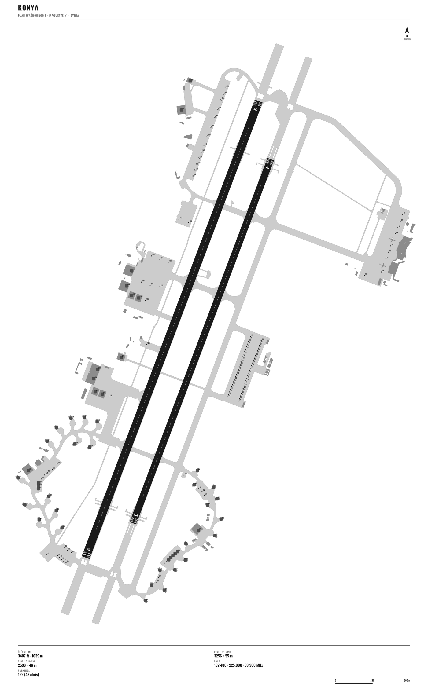
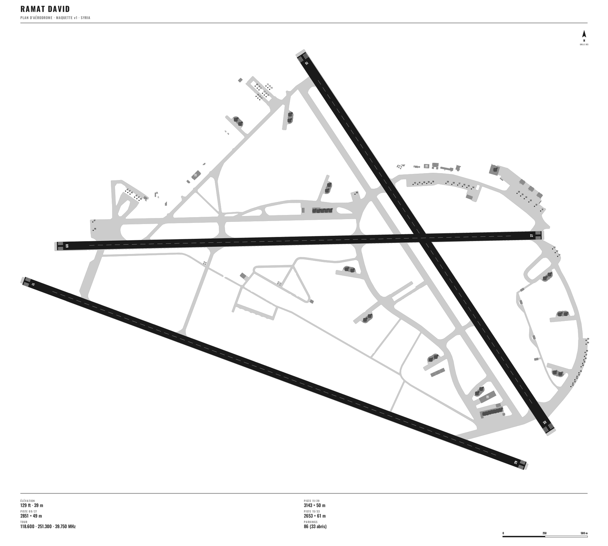
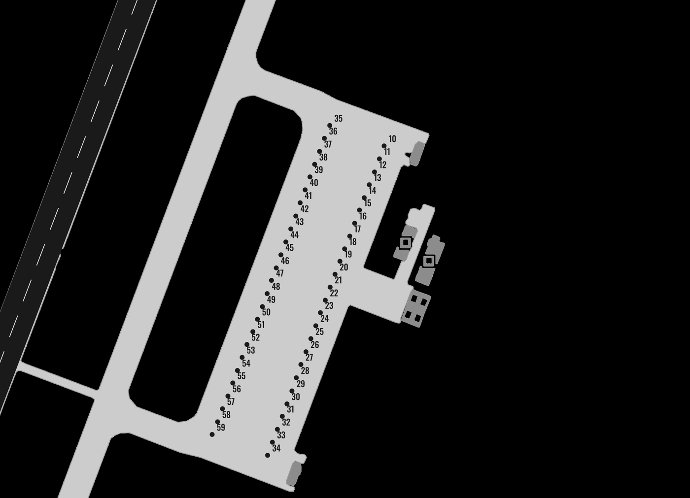

# DCS Airfield Charts

Airfield charts for DCS World, built from the game's own data.

**Status: work in progress.** The DCS F10 map (Alt mode) draws all the pavement of an airfield as flat fills, along with buildings, guidance lines and parking numbers. This repository contains the tool that captures that map, base by base, in the DCS terrain frame (`x` North, `z` East, in metres). The whole Syria theatre is captured (80 airbases, 144 heliports). Turning the captures into vector charts works in a prototype, shown below; the renderer is not in this repository yet.

The goal is to share a complete set of charts for every airfield, as PDF and PNG, ready for print and for the DCS kneeboard.

## Work in progress: first charts

Early mock-ups, generated with no manual drawing: pavement and buildings are vectorised from the F10 capture; runways are detected from their markings; runway designators, parking positions and numbers, and tower frequencies come from the game data (read through [pydcs](https://github.com/pydcs/dcs)). Hardened shelters are recognised on the map. **Not final** — text sizes, taxiway names, magnetic bearings, ILS/TACAN data and the page layout are still being worked on.

| Konya (Syria) | Ramat David (Syria) |
|---|---|
|  |  |

Detail view, Konya main apron:

## Contents

| Path | Role |
|---|---|
| `capture/hook/ChartsCaptureHook.lua` | DCS export hook: a small local server (`127.0.0.1:47123`) that places the F10 camera directly above a point, with its axes aligned to the DCS grid; releases the camera after 5 s without a command |
| `capture/f10capture.py` | captures a whole base: extent read from its `.rn4`, camera altitude adapted to the terrain, scale calibration (falls back to the predicted scale if calibration fails), image grid, mosaic; `index <Theatre>` lists every airbase and heliport of a theatre; `theatre <Theatre>` captures them all in one resumable pass (about 45 min for Syria) |
| `capture/f10probe.py` | the original probe (link, stabilisation, scale, alignment) |

## Installation (Windows)

1. Copy `ChartsCaptureHook.lua` to `Saved Games\DCS...\Scripts\ChartsCapture\`.
2. Append to the end of `Saved Games\DCS...\Scripts\Export.lua`:
   `dofile(lfs.writedir()..[[Scripts\ChartsCapture\ChartsCaptureHook.lua]])`
3. Python 3.12+ with `numpy`, `mss`, `pillow`.
4. Set up the configuration (see below).
5. Start a mission on the theatre you want, open the F10 map in Alt mode, hide labels and units, keep DCS in the foreground; then run `python -I capture/f10capture.py capture <Theatre> <Base>`.

### Configuration

Copy `capture/config.example.json` to `capture/config.json` (ignored by git) and adapt it to your PC:

| Key | Meaning |
|---|---|
| `work_dir` | working folder (required): the scripts write `out/` and `sync/` there; created if it does not exist |
| `dcs_install` | DCS World installation folder (required): terrains are read from `<dcs_install>/Mods/terrains`, which must exist |
| `screen` | screen size in pixels, `[width, height]` (optional: it can be left out, in which case the size of the primary screen is used) |

The file is looked up in this order: the `--config <path>` command-line option, otherwise the `DCS_CHARTS_CONFIG` environment variable, otherwise `capture/config.json`. `~` is expanded. If the file is missing or incomplete, the script stops with a message saying so.

## What we measured

- Image aligned with the DCS grid (deviation < 0.01°), seams between images ≤ 1 px, about 1 s per image.
- Scale: 0.33555 mm/px per metre of camera altitude. **DCS keeps the F10 camera at least ~500 m above the ground**; hence the altitude `max(1350, ground + 700)` and a calibration for each base.

## Licence

MIT — see `LICENSE`.

## Acknowledgements

The principle — driving the F10 camera from `Export.lua` and capturing the screen — comes from the map generator of [DCS Olympus](https://github.com/Pax1601/DCSOlympus). No code is taken from it.

DCS World is a trademark of Eagle Dynamics SA. This project is neither made nor endorsed by Eagle Dynamics.
